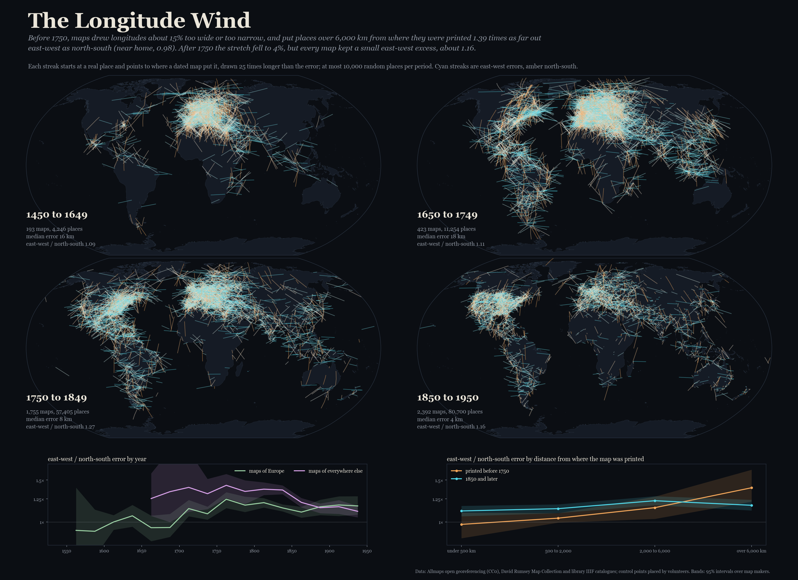
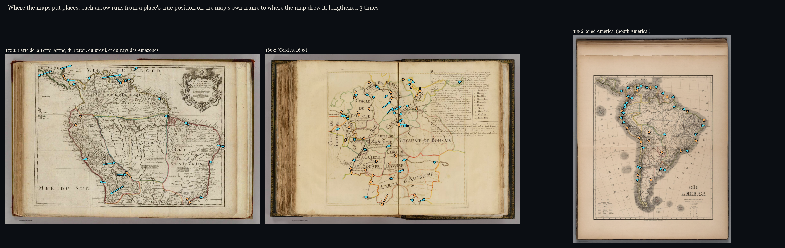
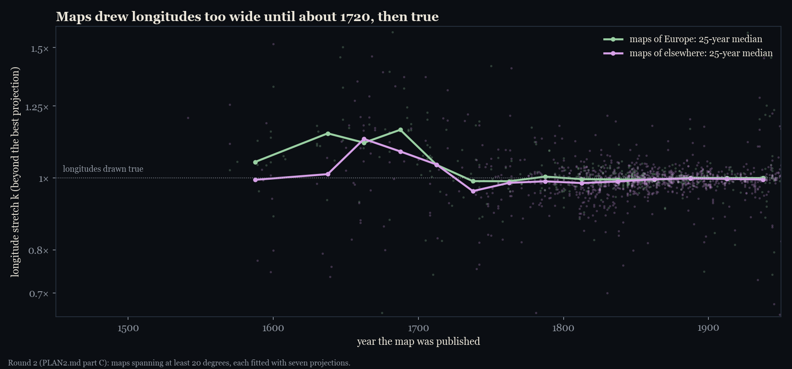
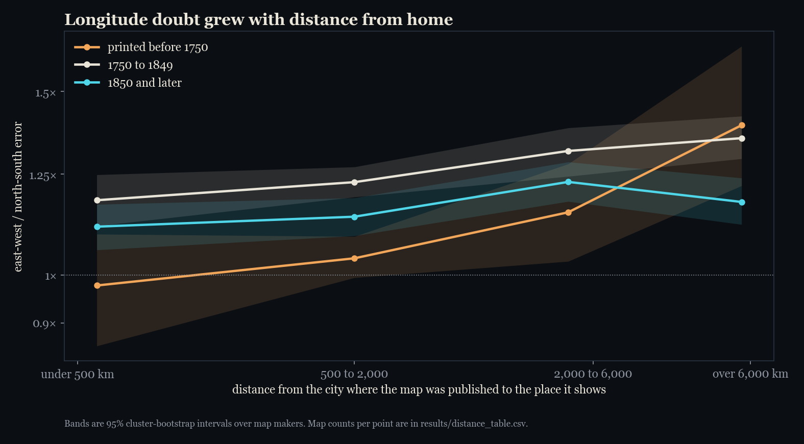
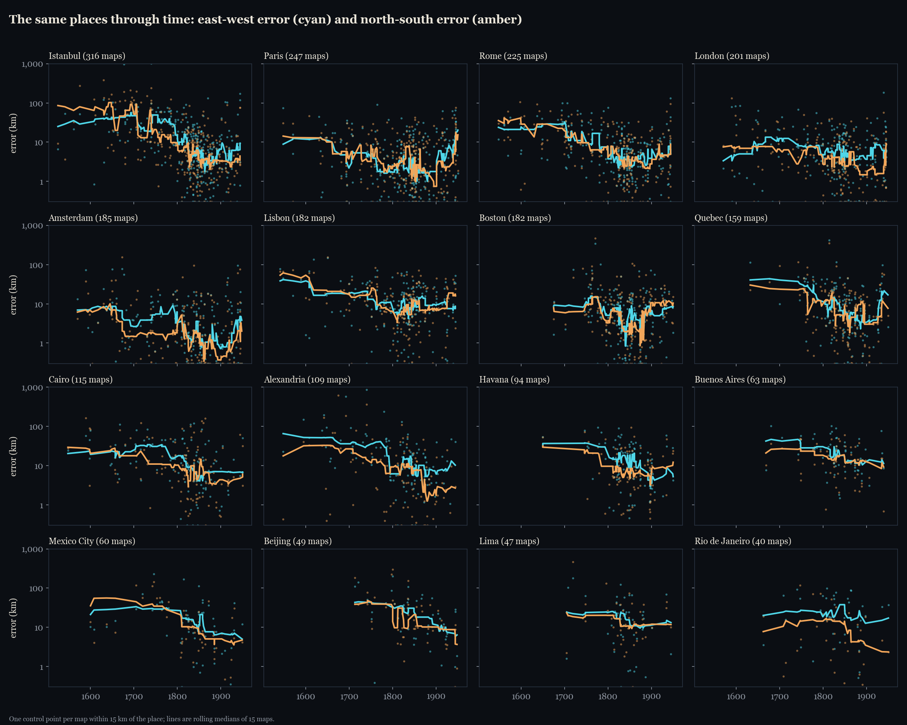
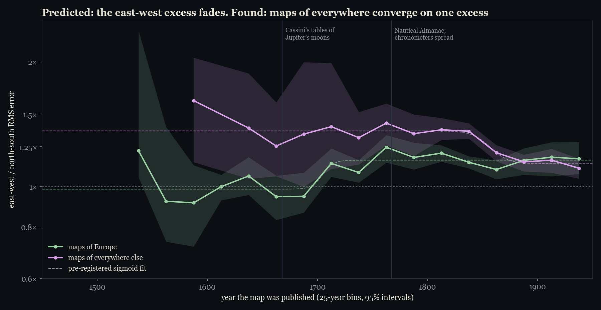
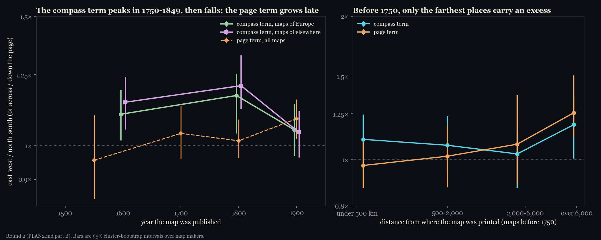
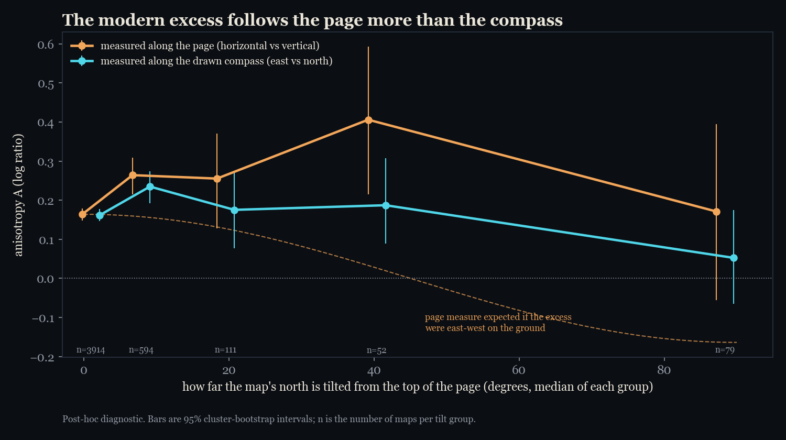
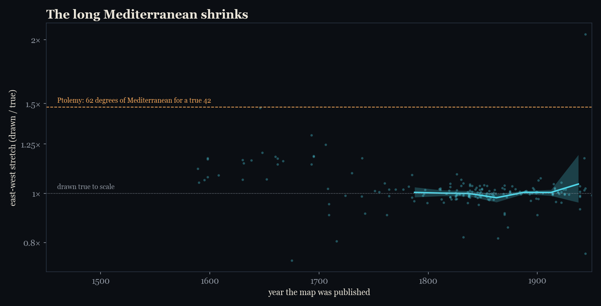
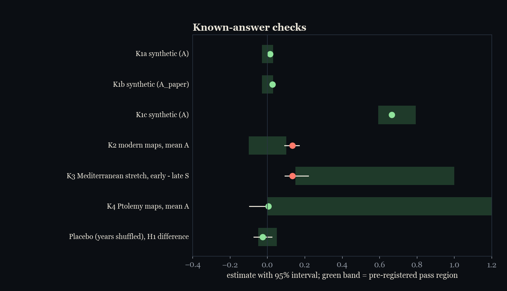

# The Longitude Wind

**Did old maps get east and west more wrong than north and south, and when did that stop?**

Before the 18th century, latitude could be read from the sun and stars, but longitude had to be estimated from travel times. This project measures what that did to maps. It uses 4,763 dated historical maps (about 154,000 places) whose control points volunteers matched to modern coordinates in [Allmaps](https://allmaps.org), and replicates the main results on 1,172 more maps from [MapWarper](https://mapwarper.net) and newer Allmaps records. It ran in two pre-registered rounds. [PLAN.md](PLAN.md) fixed round 1 before any result was computed, and [PLAN2.md](PLAN2.md) fixed round 2 before any of its statistics existed. Both plans carry dated addenda for everything decided afterwards.





The interactive map is in [`docs/index.html`](docs/index.html). Hover a map for its title, its errors and (for large maps) how far it stretched longitudes; click it to open the scan in the Allmaps viewer.

## What was found

- **Longitude error lived in the stretch, not the scatter.** For maps spanning at least 20 degrees, I fitted seven projections, each with a free longitude stretch. Maps published before 1750 drew longitudes about 15% too wide or too narrow, mostly too wide (mean |ln k| 0.148 for 1450 to 1649, 0.141 for 1650 to 1749). After 1750 the error fell to about 4% (0.045, then 0.038). The decline was pre-registered in round 2 (C1: +0.132, 95% interval +0.098 to +0.164).
- **The scatter carries the longitude effect only at the frontier.** Before 1750, places within 500 km of the city where the map was printed show no east-west excess (0.98 times). Places over 6,000 km away show 1.39 times (interval 1.22 to 1.66). After 1850 the gradient almost vanishes (1.11 near, 1.18 far). This held through four checks:
  - pre-registered in round 1 (H3);
  - a mixed model with maker and atlas effects (p = 0.002);
  - clustering by copy lineage;
  - a shuffled-year placebo, under which it disappears.
- **The pre-registered "fading excess" failed.** Round 1 predicted that maps' east-west excess in scatter would fall over time. Maps from 1500 to 1699 put places 1.06 times as far out east-west as north-south; maps from 1850 to 1950, 1.16 times. In Europe the excess appears only in the 18th century, as errors shrank.
- **Every modern map keeps a small east-west excess, and it is not an artifact of one tool.** Maps from 1900 to 1950 carry about 14% more east-west than north-south error. That failed a pre-registered known-answer check, and the excess replicates on MapWarper maps placed by other volunteers in a different interface (+0.122, interval +0.076 to +0.165). Clicking explains only about 10% of it, and printing method none: engraved, lithographed and manuscript maps carry the same excess. Whether it follows the page or the compass is unresolved. Tilted maps in Allmaps point to the page; the decomposition on MapWarper points to the compass; both intervals are wide.
- **Maps copied each other, visibly.** 4,118 pairs of maps (2.2% of 183,776 that share at least five places) have error patterns more alike than any pair printed 150 or more years apart. 111 pairs are near-identical (r > 0.9).

My reading, which goes beyond the tests:
- Early maps of Europe were compiled from itineraries, which made errors large but even in all directions.
- Maps of distant places came from voyages, where latitude was measured and longitude guessed, and that is where the scatter excess shows.
- The bigger longitude problem was systematic. Whole maps were drawn too wide, which a scatter measure cannot see, and that is why round 1 missed it.
- Once errors fell from about 17 km to 3.5 km, a small excess of unknown origin became visible on every map.

## Figures

| | |
|---|---|
|  | **Maps drew longitudes too wide until about 1720, then true** (round 2, C). Longitude stretch k for each map spanning 20 degrees or more, beyond the best of seven projections, with 25-year medians. |
|  | **Longitude doubt grew with distance from home** (round 1, H3). East-west over north-south error by distance from where the map was published, for three periods. |
|  | **The same places through time** (round 2, D). East-west and north-south error for 16 well-mapped places, one point per map. |
|  | **Europe and everywhere else converge** (round 1, H1 and H2). Distant regions start high and fall after 1850. Europe starts near 1 and rises after 1700. |
|  | **Page term and compass term** (round 2, B). The compass term peaks in 1750 to 1849 and falls after 1850. Before 1750 only the farthest places carry an excess, split between the two terms. |
|  | **On tilted maps, the excess runs more along the page** (round 1, post hoc). |
|  | **The long Mediterranean** (K3). East-west stretch of maps that span the Mediterranean. |
|  | **Round-1 known-answer checks** against their pre-registered pass regions. |

## Round 1: pre-registered tests

Primary sample: 4,763 maps with control points spanning at least 4 degrees, from 1,257 maker clusters. Intervals are 95% cluster bootstraps over makers (2,000 resamples). A is half the log ratio of summed squared east-west to north-south errors, so exp(A) is the ratio of RMS errors.

| Test | Prediction | Result | Verdict |
|---|---|---|---|
| H1 | east-west excess before 1700 above zero, and above 1850 to 1950 | A = +0.062 [+0.003, +0.130] early, +0.145 [+0.120, +0.167] late; difference -0.083 [-0.147, -0.010] | not supported |
| H1t | the excess declines, midpoint 1680 to 1830 | the fitted change is a rise (midpoint 1707) | not supported |
| H2 | Europe loses it before everywhere else | Europe's fitted change is a rise; elsewhere a decline (midpoint 1857) | not supported |
| H3 | before 1750, excess grows with distance from the place of publication, more than after 1850 | slope +0.180 [+0.084, +0.284] per tenfold distance before 1750; +0.042 [+0.003, +0.084] after 1850; difference +0.139 [+0.034, +0.258] | supported |
| S0 | total error falls with date | Spearman rho -0.58 | passed |

## Round 2: pre-registered tests

| Test | Prediction | Result | Verdict |
|---|---|---|---|
| A1 | clicking causes the page excess | two volunteers clicking the same feature disagree more across than down the page (+0.243 [+0.037, +0.421], 496 pairs on 100 scans), but that explains about 10% of the excess | anisotropic, too small |
| A2 | printing method matters (paper shrinkage) | engraved +0.205, lithograph +0.201, manuscript +0.187; engraved minus lithograph -0.047 [-0.127, +0.046] | no difference: consistent with lettering, not paper |
| B0 | the page/compass split recovers known terms | injected 0.2 recovered as 0.17 to 0.21, leak under 0.02 | passed |
| B1 | 1850 to 1950: page term above zero and above the compass term | page +0.084 [+0.025, +0.146], compass +0.047 [-0.010, +0.100], difference +0.037 [-0.071, +0.153] | not supported |
| B2 | compass term falls from 1500 to 1749 to 1850 to 1950 | +0.047 [-0.041, +0.129] | not supported |
| B3 | before 1750, compass term grows with distance | -0.001 [-0.148, +0.159] | not supported |
| C0 | stretch recovered (within 0.03) and right projection chosen (70%) | stretch error at most 0.003 in every family; right family 66% | failed on the family criterion |
| C1 | stretch falls from 1500 to 1699 to 1850 to 1950 | mean \|ln k\| difference +0.132 [+0.098, +0.164] | supported |
| C2 | Europe's stretch settles before everywhere else's | neither series stays below 0.05 in every later bin | not supported |
| C3 | Mediterranean maps before 1650 stretched by more than 0.1 | +0.123 [+0.078, +0.203] | failed (lower end below 0.1) |
| D1 | east-west error falls more than north-south after a place's first astronomical longitude | only Alexandria (1694) had enough maps: +0.131 [-1.69, +1.86] | failed, underpowered |
| E2 | H3 survives clustering by copy lineage | lineages chain into one giant cluster at the planned threshold; with near-identical copies only: +0.139 [+0.037, +0.254] | holds (see addendum) |
| E3 | H3 survives a mixed model with maker and atlas effects | +0.137 (SE 0.044, p = 0.002); dof-weighted, clustered two ways: +0.106 (p = 0.057) | supported |
| F1 | modern excess replicates on maps round 1 never saw | +0.122 [+0.076, +0.165], 678 maps | replicated |
| F2 | outside Europe, excess falls after 1850 | +0.032 [-0.050, +0.116] | not replicated |
| F3 | Europe before 1700 shows no excess | +0.024 [-0.154, +0.204], 58 maps | replicated |
| F4 | page term above zero, 1850 to 1950 | page -0.043 [-0.163, +0.124], compass +0.122 [-0.050, +0.253] | not replicated |

## Known-answer checks (round 1)

| Check | Pass region | Result | |
|---|---|---|---|
| K1a synthetic conformal maps, isotropic paper noise | mean A within 0.03 of 0 | +0.014 | pass |
| K1b synthetic non-conformal maps | mean A_paper within 0.03 of 0 | +0.026 | pass, near the limit |
| K1c synthetic, east-west error twice north-south | mean A within 0.10 of ln 2 = 0.693 | +0.664 | pass |
| K2 real maps 1900 to 1950 | mean A within 0.10 of 0 | +0.133 [+0.092, +0.169] | **fail** |
| K3 Mediterranean stretch, before 1650 minus after 1750 | at least 0.15 | +0.134 [+0.093, +0.219] | **fail**, narrowly |
| K4 maps titled after Ptolemy, 1477 to 1600 | mean A above 0 | +0.005 [-0.097, +0.012], 14 maps | passes by the letter; indistinguishable from zero |
| Placebo, years shuffled | H1 and H3 differences near 0 | -0.026 [-0.073, +0.023]; +0.006 [-0.067, +0.081] | null, as it should be |

The synthetic checks rebuild every eligible map from its real control-point layout. Each runs through one of 11 projections, then gets known noise, and the real pipeline has to read the noise back. So the K2 failure is a property of the maps, not of the fitting.

## Robustness of H1 and H2 (round 1)

| Variant | Maps | H1 difference | H2 midpoint gap (Europe minus elsewhere) |
|---|---|---|---|
| primary | 4,763 | -0.083 [-0.147, -0.008] | -152 [-247, +77] |
| R1 near-conformal aspect only | 4,400 | -0.086 [-0.151, -0.010] | -148 [-272, -98] |
| R2 anisotropy on the paper | 4,763 | -0.014 [-0.074, +0.050] | -158 [-369, +8] |
| R3 region fixed effects | 4,763 | -0.086 [-0.155, -0.007] | |
| R4 extent at least 2 degrees | 5,850 | -0.085 [-0.134, -0.024] | -150 [-240, +150] |
| R4 extent at least 8 degrees | 3,102 | -0.063 [-0.152, +0.048] | -157 [-248, -123] |
| R5 weighted by residual degrees of freedom | 4,763 | -0.122 [-0.184, -0.056] | -149 [-187, +1] |
| R6 affine fits only | 4,763 | -0.066 [-0.139, +0.010] | -133 [-176, -89] |

## Post-hoc work (not pre-registered)

Each item is recorded in a plan addendum, with outputs in `results/`.

- **A duplicate bug.** VU Amsterdam serves each scan under two URLs, so 424 maps were counted twice in the first run. The fix drops records whose control points repeat another's exactly. Every test was re-run; only K3 changed verdict, from a narrow pass to a narrow fail. The earlier outputs are kept in `results/before_dedupe/`.
- **Binding fold: no.** On 2,891 atlas maps, the jump in east-west residual across the page's centre line is +0.018 of a map's RMS error. That is far too small to matter, and residual size shows no spike there.
- **Compass or page.** When north is tilted 30 to 60 degrees on the page, the page measure is +0.41 and the compass measure +0.19. When it is tilted 60 to 120 degrees, they are +0.17 and +0.05, with intervals that overlap. Round 2 tried to settle this with every map (B), but only 10% of control points sit where drawn north is tilted more than 10 degrees, so the split stays uncertain.

| Mean A by period | 1450 to 1649 | 1650 to 1749 | 1750 to 1849 | 1850 to 1950 |
|---|---|---|---|---|
| Europe | +0.023 (154 maps) | +0.027 (290) | +0.164 (870) | +0.135 (800) |
| North America | +0.172 (7) | +0.218 (30) | +0.296 (529) | +0.140 (1,109) |
| Asia, Africa, Latin America, Oceania | +0.363 (32) | +0.288 (103) | +0.337 (356) | +0.172 (483) |

## Method

1. **Data.**
   - **Control points:** the [Allmaps open dataset](https://allmaps.org) (CC0, snapshot of 2026-10-13, 65,552 georeferenced maps) gives pixel positions on each scan matched to modern longitude and latitude.
   - **Catalogue metadata:** dates, makers and places of publication come from the David Rumsey Map Collection's public Luna JSON endpoint, and from other libraries' IIIF manifests or CONTENTdm records. Gallica and NYPL are not used, and 98 records could not be read.
   - **Replication data:** maps from the MapWarper.net API, dated by `date_depicted` or a year in the title, plus Allmaps maps created after the snapshot.
2. **Sample.** A map is kept if it:
   - has at least 6 distinct control points spanning at least 4 degrees, short of world or hemisphere maps;
   - has a publication year from 1450 to 1950, precise to 25 years;
   - is not a facsimile, a view or a globe gore;
   - is one record per scan and per identical set of control points.
3. **Scatter.** True positions are projected to an azimuthal equidistant frame centred on the map. Pixels are fitted to that frame with an affine transform, or a second-order polynomial when a map has 12 or more points. Each fitted position's error then splits into east-west and north-south kilometres.
4. **Stretch** (maps of 20 degrees or more). Seven projections with conventional parameters, each with longitudes scaled by a free factor k before projecting and a similarity transform onto the page. The best fit gives ln k.
5. **Page or compass.** On the paper, each residual's variance contrast is split into a term along the page's axes and a term along the local drawn east and north. Tilted maps and the turning meridians of large conic maps separate the two.
6. **Copies.** Two maps sharing at least five places get the correlation of their residuals there; pairs beyond the 99th percentile of maps 150 or more years apart count as copies.
7. **Statistics.** Intervals resample whole map makers. H3 is also fitted as a mixed model with maker and atlas effects.

## Limits and traps

- Volunteers place control points on recognisable features, so the most wrong maps are underrepresented.
- The Allmaps sample leans on the Rumsey collection (79%), and so on 19th-century atlas maps and North America after 1750. Before 1750 there are 616 maps, 444 of them of Europe.
- Catalogue dates are dates of printing, so maps copied from older plates carry older knowledge under newer dates. The copy analysis shows how common that is.
- MapWarper maps have no place of publication or maker, so H3 cannot be replicated there, and they are bootstrapped map by map.
- The page/compass split rests on the 10% of points where drawn north is visibly tilted. That is too little to settle the question.
- Traps hit along the way:
  - Digital Commonwealth answers 404 to an `Accept: application/json` header.
  - MapWarper ignores JSON:API `page[number]` and serves page 1 every time; use `page=` and `per_page=`.
  - Rumsey's HTML pages sit behind reCAPTCHA, but its Luna JSON endpoint does not.
  - VU Amsterdam serves every scan under two image URLs.
  - A half-closed HTTPS connection can hang urllib past its timeout; set `socket.setdefaulttimeout`.

## Reproduce

```bash
pip install -r requirements.txt
```

```bash
python src/run_all.py
```

The metadata and MapWarper fetches take about an hour each at a polite rate, and all of them resume where they stopped. `python -m pytest tests` runs 52 tests: geometry, the fit, the page/compass split, dates, geocoding and the bootstrap. The Allmaps dump is regenerated upstream twice a day. To reproduce the exact numbers, use the files fingerprinted in `data_manifest.csv` (see `DATA.md`).

## Layout

```
PLAN.md, PLAN2.md       pre-registrations for rounds 1 and 2, each with dated addenda
DATA.md                 the raw inputs, where they come from, how to rebuild them
data_manifest.csv       byte length and fingerprint of every raw input
src/download.py         Allmaps dump, GeoNames gazetteer, Natural Earth land
src/fetch_*.py          catalogue metadata (Rumsey, IIIF, CONTENTdm), MapWarper maps, new Allmaps maps
src/build_sample.py     geometric sample, one record per scan and per control-point set
src/metadata.py         dates, makers, places of publication
src/fit.py              per-map fit and error split
src/paper.py            residuals on the paper and the page/compass split
src/synthetic.py        round-1 known-answer checks K1a-c
src/analyze.py          round 1: K2-K4, H1-H3, robustness, placebo (--placebo)
src/diagnostics.py      round-1 post-hoc: binding fold, page profile, compass or page
src/round2_*.py         round 2: cause, decompose, stretch, places, lineage, replication
src/figures.py, src/figures_r2.py   figures
src/docs_data.py        data for the interactive page
src/manifest.py         writes data_manifest.csv
results/                every test's output; results/before_dedupe/ keeps the first run
docs/                   interactive map
```

## Data and licences

- Allmaps georeference data: CC0.
- MapWarper.net map metadata and control points: public API.
- Map metadata: David Rumsey Map Collection (Cartography Associates), Vrije Universiteit Amsterdam, Digital Commonwealth / Leventhal Map & Education Center, University of Amsterdam, and 32 more IIIF providers. These are listed per map in `results/map_stats.csv`.
- Scan images in the portraits: David Rumsey Map Collection, via IIIF.
- Gazetteer: GeoNames (CC BY 4.0).
- Land outlines: Natural Earth (public domain).

Code: MIT.
